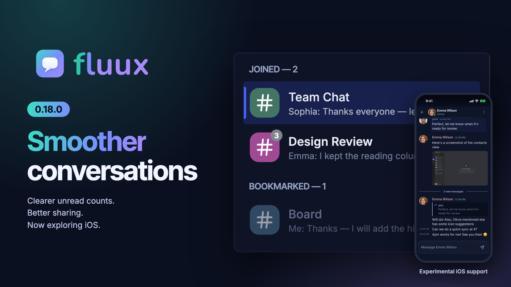
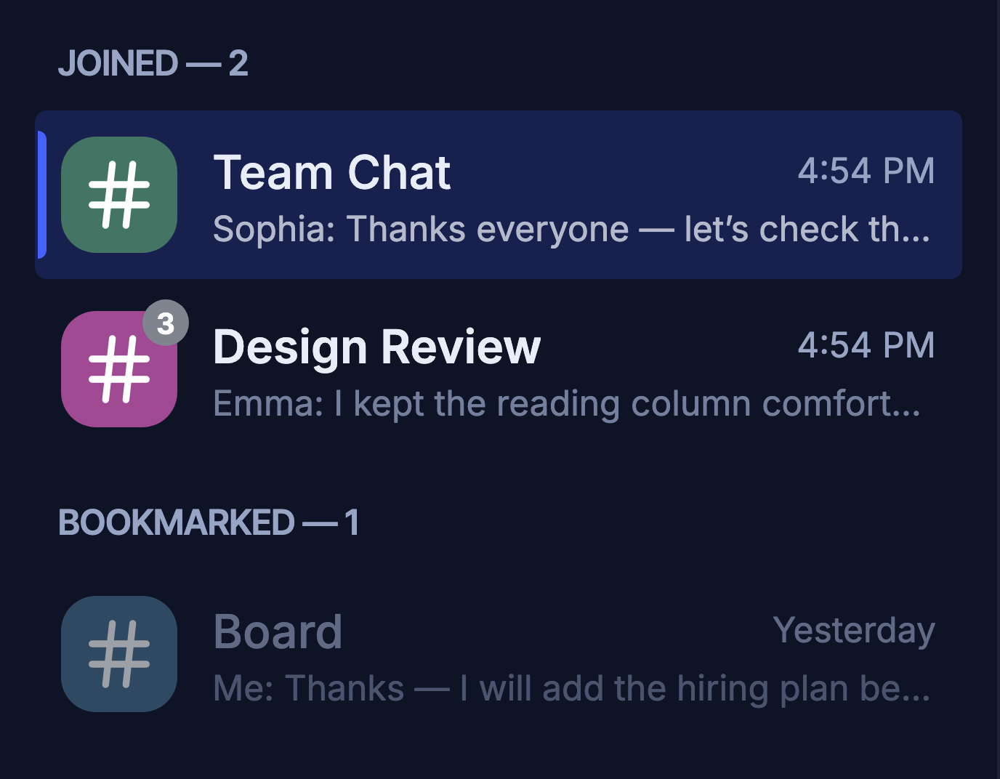
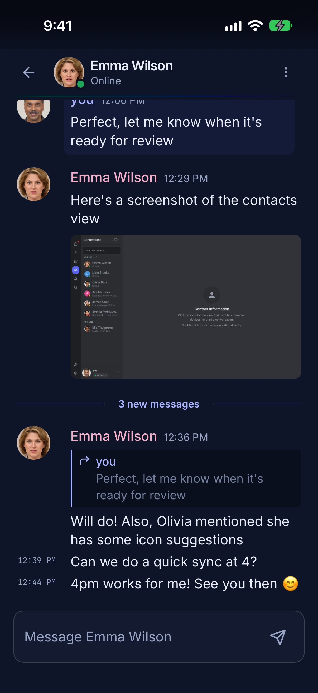

# Fluux Messenger 0.18.0: smoother history, clearer unread counts, and better sharing

Publication date: [To confirm]

Fluux Messenger 0.18.0 focuses on the parts of messaging you rely on every day: opening a long conversation, catching up after a disconnect, and knowing what remains unread. It also makes sharing easier on macOS and introduces experimental native iOS support for iPhone.

If you are discovering Fluux, it is an open-source XMPP client for teams, communities, and anyone who wants control over their communications. This release keeps the focus on making those conversations easier to follow.

## Smoother history, from opening to catching up

Long conversations open more smoothly, including those with large blocks of text. Catching up on archived history is faster when thousands of messages are already loaded, and busy rooms no longer stall or crash during bursts of messages and presence updates.

History is easier to navigate, too. When a conversation contains several gaps, Fluux can show and fill each one separately. Search's “Go to message” now reaches and highlights results far back in both direct chats and rooms.

The view stays steadier while you read. Reopening a room with short multi-line messages no longer makes it jump. The last message stays visible above the typing indicator and composer, and the scroll-to-bottom button appears as soon as you move away from the latest messages.

## Clearer unread counts

Unread badges now recover correctly after a reconnect and catch-up. A room read through to its latest message clears its badge. A read position from another device that Fluux cannot yet place no longer blocks unread counts.

The “New messages” divider now counts the messages actually below it, rather than repeating the unread total on the scroll-to-bottom badge. Joined room avatars show unread message counts, while mentions keep their own badge.

Messages from ignored room members no longer add to unread or mention badges. Messages you send from another device under a different room nickname are recognised as yours, without an extra notification or unread count.

## Better sharing, with the context you need

On macOS, you can share links, documents, and images to Fluux from another app's system Share menu. Fluux opens so you can choose the conversation and send the content.

Whispers to a room member can now include attachments. Before you send, Fluux explains that the file is stored on the server and that the recipient keeps a copy. When the server provides a retention period, Fluux shows that too.

Desktop file handling also gets a practical fix: attaching or opening files with non-Latin names works again.

## Experimental iOS support for iPhone

Version 0.18.0 introduces experimental native iOS support, with push notifications, system sharing, native file transfers, and OpenPGP encryption.

Photos shared from another app open in Fluux ready to send. Large photos are reduced before sharing, with the option to send the original when it fits the server's limit.

Notifications can show contact and room avatars, and OpenPGP message previews can be decrypted on the device. Those previews start enabled for accounts with OpenPGP enabled and a usable key; you can turn them off for each account in Notifications settings. The app switcher hides your conversations behind a blurred cover.

On iOS 16 or later, Siri and Shortcuts can open an existing conversation or room, or check the unread count shown on the app icon.

This support is experimental. [Subscribe to the ProcessOne newsletter](https://www.process-one.net/#/portal/signup) to hear when TestFlight testing opens.

## More comfortable reading, more dependable conversations

For wide windows, Accessibility settings now offer “Limit conversation width”, with a slider to choose a centred reading column. Small windows continue to use the full width. Presence indicators also use more distinct shapes: Away is an orange rounded square, and Do Not Disturb is a red ring.

OpenPGP conversations work better alongside Gajim, including encrypted edits, replies, receipts, and read markers. Deleted messages stay deleted after a restart and archive sync, rather than returning to the conversation or search.

On macOS, Fluux no longer crashes when waking from sleep in the background. On Linux desktops using XEmbed trays, closing the window keeps Fluux running in the tray. Reopening Fluux keeps your conversations on screen while it reconnects, instead of briefly showing the login form.

## Get Fluux Messenger

[Download Fluux Messenger for macOS, Windows, and Linux](https://www.process-one.net/download/fluux-messenger/), or visit the [Fluux Messenger page](https://www.process-one.net/fluux-messenger/) to explore the app and try it in your browser.

See the [full 0.18.0 release notes](https://github.com/processone/fluux-messenger/blob/main/RELEASE_NOTES.md) for the complete list of changes.

If something still feels off, tell us. Bug reports and feature requests both go to [GitHub Issues](https://github.com/processone/fluux-messenger/issues).
